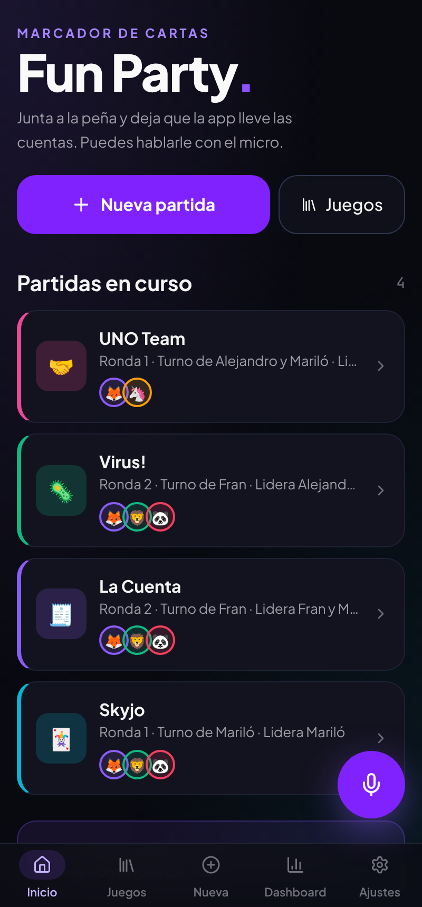
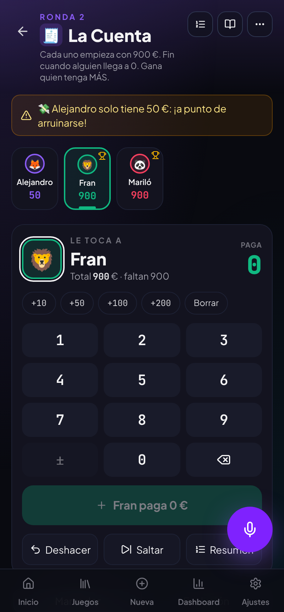
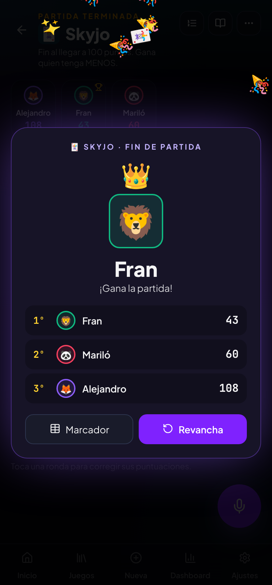
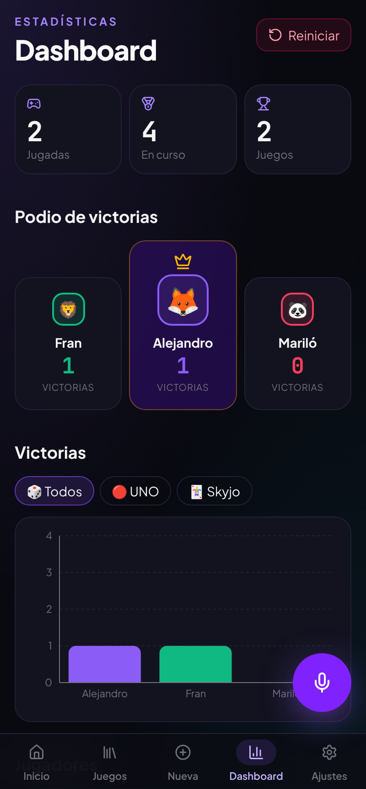

# Fun Party · Marcador de juegos de cartas

Marcador para jugar a cartas en grupo: lleva las cuentas de **Skyjo, Flip 7, La Cuenta, UNO, Virus!, Skull King…**, avisa de quién está a punto de ganar, celebra al ganador y guarda estadísticas. Se puede manejar **con la voz** («Skyjo, Mariló, menos 3 puntos») o escribiendo los comandos.

Es una reconstrucción funcional, independiente y con código propio de la aplicación *Fun Scorekeeper* publicada en Emergent. El inventario de funcionalidades, cómo se obtuvo y qué partes no se pudieron observar están en [`docs/AUDITORIA.md`](docs/AUDITORIA.md).

<p align="center">
  
  
  
  
</p>

---

## Funcionalidades

| Área | Qué hace |
|---|---|
| **Inicio** | Partidas en curso (ronda, turno y líder), accesos rápidos y ayuda de voz. |
| **Juegos** | Catálogo de 20 juegos con buscador, juegos ocultos y alta de juegos (a mano o con IA opcional). |
| **Ficha de juego** | Objetivo, preparación, normas paso a paso y puntuación. Galería (subir foto, enlace o BoardGameGeek), icono, parámetros editables, ocultar y restablecer los valores oficiales. |
| **Nueva partida** | Elegir juego y jugadores (habituales, por nombre o uno nuevo), orden de turno, color único por partida, parejas (sorteo o a mano) y ajuste de la puntuación. |
| **Partida** | Teclado con ± y atajos +N; anotar fuera de turno; Deshacer, Saltar y Ronda completa; corregir o eliminar rondas. También marcador, gráfico de evolución, resumen, normas, avisos de fin, terminar, reabrir, revancha y celebración con confeti y empates. |
| **Tipos de marcador** | Sumar puntos o presupuesto que se gasta. Gana quien tenga más o menos. Fin por objetivo, por nº de rondas, cuando alguien llega a 0 o manual. Se anota todos por ronda o uno por anotación. Hay botón directo de victoria para los juegos que cuentan victorias. |
| **Dashboard** | Totales, podio, gráfico de victorias filtrable por juego, estadísticas por jugador y por juego, y últimas partidas. "Reiniciar" fija desde cuándo se cuenta y se puede deshacer. |
| **Ajustes** | Jugadores (crear, editar, borrar, habituales ordenables), juegos, guía de voz e historial de partidas. |
| **Voz** | Reconocimiento y síntesis de voz en español (Web Speech API), con entrada de texto alternativa. |

## Arquitectura

```
fun-party/
├─ server/                 API REST + SQLite (Node 20+, Express 5, better-sqlite3, TypeScript)
│  ├─ src/engine/          Motor de puntuación puro (totales, turnos, fin, avisos, ranking)
│  ├─ src/routes/          games · players · matches · stats
│  ├─ src/lib/             utilidades HTTP, constantes, integraciones opcionales (IA, BGG)
│  ├─ src/seed-games.json  Catálogo oficial de 20 juegos (se carga la primera vez)
│  └─ test/                Tests del motor y de la API (Vitest + Supertest)
├─ client/                 SPA React 19 + Vite + Tailwind v4 + TanStack Query + Motion + Recharts
│  └─ src/{pages,components,hooks,lib}
├─ e2e/run.mjs             Recorrido completo en navegador (Playwright)
└─ docs/AUDITORIA.md       Inventario de la app original y decisiones de reconstrucción
```

- El **servidor** calcula los campos derivados de cada partida: `totals`, `ranking`, `current_player_id`, `current_round`, `round_complete`, `alerts` y `chart`. El cliente solo los pinta, así que la lógica de puntuación está en un único sitio y tiene tests.
- **Persistencia:** SQLite en un solo fichero (`server/data/fun-party.db` por defecto). Se crea solo y no hace falta instalar nada.
- En **producción**, el servidor también sirve el frontend compilado, así que todo funciona desde un único puerto.

## Requisitos

- **Node.js 20 o superior** (probado con 22) y npm 10.
- `better-sqlite3` usa binarios precompilados. Si tu plataforma no los tiene, necesitarás herramientas de compilación (Python 3 y un compilador de C++).

## Instalación y ejecución

```bash
git clone <tu-repo>/fun-party.git
cd fun-party
npm install
```

### Desarrollo (recarga en caliente)

```bash
npm run dev
```

- Web: <http://localhost:5173> (Vite redirige `/api` al servidor)
- API: <http://localhost:8001/api>

### Producción

```bash
npm run build      # compila cliente y servidor
npm start          # sirve web + API en http://localhost:8001
```

### Docker

```bash
docker build -t fun-party .
docker run -p 8001:8001 -v fun-party-data:/app/server/data fun-party
```

### Usarlo desde el móvil

Arranca con `npm start` y abre `http://<IP-de-tu-ordenador>:8001` desde el móvil en la misma red. El micrófono del navegador solo funciona en **HTTPS** o en `localhost`, así que para usar la voz en el móvil publica la app tras un proxy con HTTPS (Caddy, Nginx, Cloudflare Tunnel…). La entrada escrita funciona siempre.

## Configuración (variables de entorno)

Copia `.env.example` a `.env` o define las variables en tu sistema. Todas son opcionales.

| Variable | Por defecto | Uso |
|---|---|---|
| `PORT` | `8001` | Puerto del servidor. |
| `DB_FILE` | `server/data/fun-party.db` | Ruta del fichero SQLite. |
| `STATIC_DIR` | `client/dist` | Carpeta del frontend compilado. |
| `ANTHROPIC_API_KEY` | — | Activa «Crear ficha con IA». Sin ella, el botón aparece desactivado y explica el motivo. |
| `AI_MODEL` | `claude-sonnet-5-5` | Modelo usado para generar la ficha. |
| `BGG_API_TOKEN` | — | Activa «Importar desde BoardGameGeek» (la API XML de BGG exige token). |
| `VITE_API_URL` | (mismo origen) | Solo si sirves el frontend en otro dominio que la API. |

El repositorio no incluye ninguna clave ni credencial.

## Tests

```bash
npm test                 # motor + API (servidor) y parser de voz (cliente)
npm run typecheck        # TypeScript estricto en ambos paquetes
```

Recorrido E2E en navegador (opcional; necesita Playwright y Chrome/Chromium):

```bash
npm i -D playwright && npx playwright install chromium
npm run build && DB_FILE=/tmp/e2e.db npm start &   # usa una base de datos vacía
BASE_URL=http://localhost:8001 npm run e2e
```

El recorrido da de alta jugadores y juega partidas de Skyjo, UNO, La Cuenta, Virus! y UNO Team. Usa la voz escrita y el Dashboard, y comprueba los resultados contra la API (38 comprobaciones). Las capturas se guardan en `e2e/screenshots/`.

## API

| Método | Ruta | Descripción |
|---|---|---|
| GET/POST | `/api/games` | Listar / crear juego (manual). |
| POST | `/api/games/ai` | Crear ficha con IA (requiere `ANTHROPIC_API_KEY`). |
| GET/PUT/DELETE | `/api/games/:id` | Ver / editar (parámetros, imágenes, ocultar) / borrar (solo juegos creados por ti). |
| POST | `/api/games/:id/reset` | Restablecer valores oficiales. |
| POST | `/api/games/:id/bgg` | Importar imagen de BoardGameGeek (requiere `BGG_API_TOKEN`). |
| GET/POST | `/api/players` | Listar / crear jugador. |
| PUT/DELETE | `/api/players/:id` | Editar / borrar jugador. |
| PUT | `/api/players/order` | Reordenar habituales `{ ids }`. |
| GET/POST | `/api/matches` | Listar / crear partida `{ game_id, players, teams?, settings? }`. |
| GET/DELETE | `/api/matches/:id` | Ver / borrar partida. |
| POST | `/api/matches/:id/scores` | Anotar `{ player_id, value }`. |
| POST | `/api/matches/:id/skip` · `/undo` | Saltar turno · deshacer. |
| POST | `/api/matches/:id/rounds` | Ronda completa `{ entries }`. |
| PUT/DELETE | `/api/matches/:id/rounds/:rid` | Corregir / eliminar ronda. |
| POST | `/api/matches/:id/finish` · `/reopen` · `/rematch` | Terminar · reabrir · revancha. |
| GET | `/api/stats` | Estadísticas del Dashboard. |
| POST | `/api/stats/reset` · `/reset/undo` | Reiniciar · deshacer reinicio. |

## Notas sobre imágenes y marcas

Las fichas de juego enlazan (no copian) las imágenes públicas de BoardGameGeek, igual que la app original. Si una imagen no carga, se muestra el emoji del juego. Los nombres de los juegos y sus normas resumidas pertenecen a sus editoriales.

## Licencia

MIT. Consulta [`LICENSE`](LICENSE).
